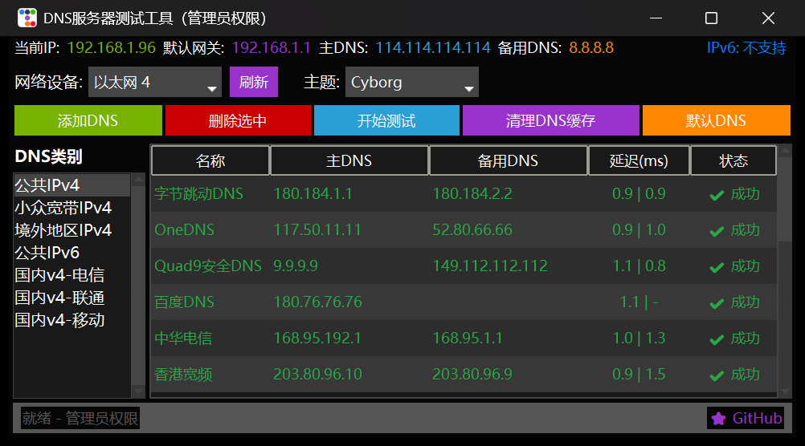

<div align="center">
  

  <h1>DNS Tester</h1>

  <p>Windows 平台的 DNS 服务器测速与一键切换工具</p>

  <p>
    <a href="https://github.com/pcoof/dns/releases/latest"></a>
    <a href="https://github.com/pcoof/dns/releases"></a>
    
    
    <a href="LICENSE"></a>
  </p>
</div>



## 简介

DNS Tester 面向需要经常换 DNS 的 Windows 用户：内置公共 DNS、各省运营商 DNS、境外地区和安全 DNS 分类列表，一键并发测速，把响应最快的那台直接写进系统。

所有网络操作走 WMI COM，操作过程不会弹出命令行黑窗，也不需要你记住 `netsh` 的参数。

## 功能

- **并发测速** — 多线程同时测试，主/备 DNS 延迟分开显示（如 `0.9 | 1.2`），结果按速度自动排序
- **一键切换** — 双击任意条目即写入系统 DNS；「默认 DNS」恢复到 DHCP 自动获取
- **分类管理** — 公共 IPv4/IPv6、国内电信/联通/移动、境外地区、小众宽带等分类，可增删改
- **网卡识别** — 自动枚举网络适配器，切换 DNS 前可指定目标网卡
- **分类排序** — 分类顺序与上次选择会被记住，下次启动直接回到原位置
- **历史记录** — 保留最近 1000 条测试结果，便于对比不同时间的表现
- **多主题** — 17 种 ttkbootstrap 主题，深色浅色自由切换，偏好自动保存
- **状态总览** — 顶部实时显示当前 IP、默认网关、主备 DNS 与 IPv6 支持情况

## 下载

前往 [Releases](https://github.com/pcoof/dns/releases/latest) 下载最新版本：

| 版本 | 文件 | 适用场景 |
|------|------|----------|
| 便携版 | `DNS-Tester-Portable.zip` | 解压即用，含预置 DNS 列表，可放 U 盘 |
| 安装版 | `DNS-Tester-Setup.exe` | 含开始菜单与桌面快捷方式，支持标准卸载 |

两个版本都无需安装 Python 或任何运行时。下载后可用 Release 附带的 `checksums.txt` 校验 SHA256。

## 使用

1. 启动程序（会自动请求管理员权限）
2. 顶部选择要配置的网络设备
3. 左侧选择 DNS 分类，点击 **开始测试** 并发测速
4. 双击结果中理想的一行，即可设为系统 DNS
5. 想还原时点击 **默认 DNS**，恢复为 DHCP 自动获取

> 为了修改系统 DNS，程序**必须**以管理员身份运行，启动时会自动提权。这是 Windows 的限制，不是程序缺陷。

## 从源码运行

```bash
# 依赖由 uv 管理（锁定 uv.lock）
uv sync

# 需要管理员终端
uv run python main.py
```

开发与检查：

```bash
uv sync --extra dev
uv run pytest -q          # 单元测试（全部基于 mock，不触网）
ruff check .              # 静态检查
```

## 项目结构

```
main.py              入口：权限检查 → 创建窗口 → 主循环
config/              常量、路径解析、数据模型、INI 读写
core/                并行测试、WMI 网络操作、配置业务逻辑
ui/                  主界面与对话框
utils/               日志、历史、代理检测、WMI 上下文、导出
assets/              图标、界面截图、便携版说明
packaging/           Inno Setup 安装脚本
docs/                构建说明、优化记录、发布模板
tests/               pytest 单元测试
```

配置、历史与日志统一保存在**程序所在目录**（`dns_config.ini` / `dns_history.json` / `dns_tester.log`），与启动时的工作目录无关。

## 构建与发布

构建全部在 GitHub Actions 完成（`.github/workflows/build.yml`）：

- 推送 `main`：跑 ruff + pytest，并产出构建产物（artifact）
- 推送 `v*` 标签：额外创建 Release，附便携版与安装包

```bash
# 发布新版本
git tag v2.0.1
git push origin v2.0.1
```

版本号优先取 tag 名，其次取 `pyproject.toml` 的 `version`，两者建议保持一致。

## 许可

[MIT](LICENSE)

---

问题反馈请提 [Issue](https://github.com/pcoof/dns/issues)。
